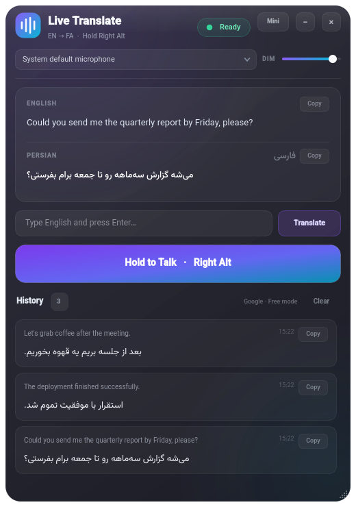
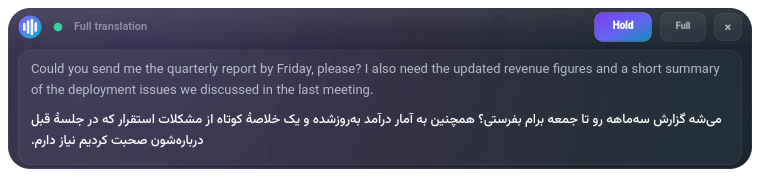

# Live Translate

**A real-time English → Persian voice translation overlay for Linux / Wayland.**

<p align="center">
  
</p>

<p align="center">
  <a href="https://github.com/JafariHosein/live-translate/releases/latest"></a>
  <a href="LICENSE"></a>
  
  
  <a href="https://github.com/JafariHosein/live-translate/actions/workflows/ci.yml"></a>
</p>

Live Translate is a compact, always-on-top, glassmorphic **PyQt6** overlay that
listens while you hold a key (or translates text you type), transcribes English
speech, and shows a fluent Persian (Farsi) translation — with a scrollable
history, copy buttons, microphone selection, opacity control, and a slim
one-line mode.

Built for **Arch Linux + Wayland**, tested on **KDE Plasma 6 / KWin** and
PipeWire. No API key is required for the default provider.

> **فارسی:** یک اوورلی شیشه‌ای و همیشه‌رو برای ترجمهٔ هم‌زمان گفتار انگلیسی به
> فارسی روی لینوکس/وی‌لند. برای شروع، فایل ریلیز را دانلود کنید یا از سورس نصب
> کنید؛ راهنمای کامل پایین آمده است.

## Download

The latest release ships a **self-contained x86_64 executable** (Python, Qt 6,
providers and fonts are bundled). Python is not required on the target machine.

**[→ Download the latest release](https://github.com/JafariHosein/live-translate/releases/latest)**

```bash
tar -xzf live-translate-1.0.0-linux-x86_64.tar.gz
cd live-translate-1.0.0-linux-x86_64
./install.sh          # installs ~/.local/bin/live-translate + app launcher
live-translate
```

System prerequisites are still required: `portaudio`, PipeWire or PulseAudio,
`flac`, and membership in the `input` group for the global hotkey. See
[Requirements](#requirements) and
[Global hotkey permissions](#3-global-hotkey-permissions).

> The executable is built for x86_64 glibc systems. It is tested on Arch Linux;
> musl-based distributions (Alpine) are not supported.

## Mini mode

<p align="center">
  <br>
  
</p>

The slim bar stays out of the way while you work. When a translation does not
fit on one line, it grows temporarily to show the complete English and Persian
text, then returns to its one-line height. Long text stays open while the
pointer is over the overlay.

## Features

- **Push-to-talk** with a global `evdev` hotkey (default `Right Alt`) or the
  in-app hold button. Works while another window is focused.
- **Type to translate** when speaking is not convenient: type or paste English
  below the result card and press **Enter**.
- **Mini mode**: a one-row overlay that expands automatically for long
  translations. **Full** restores the complete window; the choice is remembered.
- **Two provider modes**
  - **Free (default):** Google Web Speech STT through `SpeechRecognition` and
    Google Translate through `deep-translator`. If the HTML endpoint is
    rate-limited, the app automatically falls back to Google's lightweight JSON
    endpoint.
  - **Groq (optional):** `whisper-large-v3-turbo` for STT and
    `llama-3.3-70b-versatile` for natural, conversational Persian.
- **Non-blocking everywhere:** recording, hotkey listening, STT and translation
  run on `QThread`s and communicate with the UI only through Qt signals. The
  window never freezes while a request is in flight.
- **RTL/LTR aware:** Persian is right-aligned with bundled
  [Vazirmatn](https://github.com/rastikerdar/vazirmatn) fonts; English stays LTR.
- **History** with one-click copy for each side and a clear-history action.
- **Controls:** microphone picker, opacity slider, system tray, safe shutdown.
- **Wayland-native:** a frameless translucent Qt Wayland window. Compositor
  recipes for KDE Plasma, Hyprland and GNOME are included.

## Requirements

| Requirement | Notes |
| --- | --- |
| Arch Linux or an Arch derivative | The project targets Arch; other glibc distros usually work |
| Wayland session | KDE Plasma, Hyprland, GNOME, sway, … |
| PipeWire or PulseAudio | PipeWire is recommended and tested |
| Python 3.10+ | Only for the source install; the release executable bundles Python |
| Internet connection | Speech recognition and translation are online services |

## Install from a release

1. Install the runtime packages:

   ```bash
   sudo pacman -S --needed portaudio flac pipewire pipewire-pulse
   ```

2. Download the latest `live-translate-*-linux-x86_64.tar.gz` from
   [Releases](https://github.com/JafariHosein/live-translate/releases/latest),
   then extract and install it **as your user** (do not use `sudo`):

   ```bash
   tar -xzf live-translate-1.0.0-linux-x86_64.tar.gz
   cd live-translate-1.0.0-linux-x86_64
   ./install.sh
   live-translate
   ```

   `install.sh` installs the executable to `~/.local/bin`, a desktop entry to
   `~/.local/share/applications`, and the icon to the hicolor theme. If
   `~/.local/bin` is not on your `PATH`, use the absolute path or add it to your
   shell profile.

3. Join the `input` group for the global hotkey (see
   [Global hotkey permissions](#3-global-hotkey-permissions)). The in-app
   **Hold to Talk** button works before you log out.

## Install from source

### 1. System packages

```bash
sudo pacman -S --needed python portaudio flac pipewire pipewire-pulse qt6-wayland
```

| Package | Why |
| --- | --- |
| `python` | Runs the app and creates the virtual environment |
| `portaudio` | Backend used by `sounddevice` |
| `flac` | Google Web Speech needs `flac` to prepare audio |
| `pipewire`, `pipewire-pulse` | Audio server (skip if you already use PulseAudio) |
| `qt6-wayland` | Qt Wayland platform plugin |

Optional but useful: `noto-fonts` (fallback glyphs) and `pavucontrol` (mic
levels). The Vazirmatn fonts are bundled in `assets/fonts/`, so no font package
is required. If `pactl info` does not mention PipeWire/PulseAudio, fix your audio
server before continuing.

### 2. Python environment

Arch marks the system Python as externally managed. Never install these
dependencies with `sudo pip` or `--break-system-packages`; use a virtual
environment:

```bash
git clone https://github.com/JafariHosein/live-translate.git
cd live-translate
python -m venv .venv
.venv/bin/python -m pip install --upgrade pip
.venv/bin/pip install -r requirements.txt
```

Check that PyQt6 can see the Wayland platform plugin:

```bash
QT_QPA_PLATFORM=wayland .venv/bin/python -c \
  "from PyQt6.QtWidgets import QApplication; a=QApplication([]); print(a.platformName())"
# expected: wayland
```

### 3. Global hotkey permissions

`evdev` reads keyboards directly from `/dev/input/event*`. Those devices are
normally owned by `root:input`, so your user must be in the `input` group:

```bash
sudo usermod -aG input "$USER"
```

Then **log out and back in** (or reboot) so the new group applies. Verify the
current login session and the account database separately:

```bash
id -nG | tr ' ' '\n' | grep -x input            # current session
id -nG "$USER" | tr ' ' '\n' | grep -x input    # account database
```

If the second command prints `input` but the first does not, the change is
pending in this login. `./run.sh` automatically activates the new group with
`newgrp` for that launch, so you can test without logging out. For the
standalone build use:

```bash
newgrp input -c ./dist/live-translate
```

Logging out and back in makes the membership permanent. If you skip this step,
the app still works: it shows a warning with the fix, and the **Hold to Talk**
button remains fully functional.

> **Security note:** membership in `input` allows reading every keystroke on the
> machine. That is the standard trade-off for Wayland global hotkeys; only add
> trusted users to the group. If you prefer a different key, set
> `LIVE_TRANSLATE_PTT_KEY` (for example `KEY_F8`).

### 4. Configuration

The defaults need no configuration. To customise, create a `.env` file:

```bash
cp .env.example .env
chmod 600 .env
```

Settings are read from (highest priority first):

1. real environment variables,
2. `~/.config/live-translate/.env` (recommended for a permanent setup),
3. `<project>/.env`.

Frequently used variables:

| Variable | Default | Description |
| --- | --- | --- |
| `LIVE_TRANSLATE_PROVIDER` | `free` | `free` or `groq` |
| `GROQ_API_KEY` | — | Required for `groq` ([free key](https://console.groq.com/keys)) |
| `GROQ_STT_MODEL` | `whisper-large-v3-turbo` | Groq transcription model |
| `GROQ_TRANSLATION_MODEL` | `llama-3.3-70b-versatile` | Groq translation model |
| `LIVE_TRANSLATE_PTT_KEY` | `KEY_RIGHTALT` | Any evdev key name or numeric code |
| `LIVE_TRANSLATE_MIN_SECONDS` | `0.3` | Ignore taps shorter than this |
| `LIVE_TRANSLATE_OPACITY` | `0.95` | Initial panel opacity (0.35–1.0) |
| `LIVE_TRANSLATE_HISTORY_LIMIT` | `40` | Maximum history entries |
| `LIVE_TRANSLATE_LOG_LEVEL` | `INFO` | `DEBUG`, `INFO`, `WARNING`, `ERROR` |

See [`.env.example`](.env.example) for the complete list. The opacity slider and
microphone choice made in the UI are remembered separately via `QSettings`.

#### Groq mode

```dotenv
LIVE_TRANSLATE_PROVIDER=groq
GROQ_API_KEY=gsk_your_key_here
```

Groq is usually faster and more robust than the free endpoints, and its
translation is better at natural spoken Persian. Free mode sends audio to
Google; Groq mode sends audio/text to Groq. Choose according to your privacy
preferences.

### 5. Run

```bash
./run.sh
```

Or directly:

```bash
.venv/bin/python main.py
```

Prefer `./run.sh` until you have logged out and back in after adding the `input`
group: it activates the pending membership automatically for that launch.

Hold **Right Alt** (or the **Hold to Talk** button), speak English, and release.
The transcript and Persian translation appear in the main card, and the pair is
added to the history. Alternatively, type or paste English into the input under
the result card and press **Enter** (or click **Translate**).

## Usage

- **Mini** collapses the overlay into a single slim row with the latest pair and
  a compact **Hold** button. If the translation does not fit on one line, the bar
  expands for about ten seconds so the whole text is readable (hovering keeps it
  open), then returns to one row. **Full** restores the complete window. The
  choice is remembered on the next launch.
- `−` minimizes to the system tray. If no tray is available, it collapses the
  panel body instead.
- `×` quits the application.
- Drag anywhere in the header (or the compact bar) to move the overlay; drag the
  bottom-right grip to resize the full view.
- Status pill: **Ready**, **Listening** (pulsing dot), **Translating**,
  **Warning**, **Error**.
- Recordings shorter than 0.3 s are ignored so an accidental tap does not send
  an empty request.

Logs are written to `~/.local/state/live-translate/live-translate.log`.

## Build a standalone executable

To run without a virtual environment, build a single self-contained executable.
It bundles Python, Qt 6, the transcription/translation libraries and the fonts:

```bash
./build.sh                    # installs PyInstaller into .venv if needed
./dist/live-translate         # launch
./dist/live-translate --self-test   # check imports, assets and translation
./dist/live-translate --version
```

The one-file build is about 130 MB and still uses the system audio stack:
`portaudio`, PipeWire/PulseAudio, `flac`, and the `input` group for the hotkey
are required. While group membership is pending in the current login, start it
with `newgrp input -c ./dist/live-translate` or log out and back in.

At runtime, configuration is read from `~/.config/live-translate/.env`, then
`.env` beside the executable, then the executable's parent directory (so
`dist/live-translate` also picks up the project's `.env`).

Put it on your `PATH` with:

```bash
mkdir -p ~/.local/bin
ln -sf "$PWD/dist/live-translate" ~/.local/bin/live-translate
live-translate
```

To rebuild the release tarball:

```bash
./build.sh
./packaging/make-release.sh
# dist/live-translate-1.0.0-linux-x86_64.tar.gz (+ .sha256)
```

`build/` and `dist/` are git-ignored.

## Always-on-top on Wayland

Wayland deliberately gives compositors the final say over stacking. Qt's
`WindowStaysOnTopHint` is **ignored by KWin for native Wayland windows** (the app
still sets it for X11 and other compositors). Use the compositor-specific setup
below. The window's app id / WM class is **`live-translate`**.

### KDE Plasma (KWin) — bundled KWin script

The repository includes a small KWin script that marks the overlay as *keep
above* and *on all desktops*, including new virtual desktops.

```bash
# from the project or extracted release directory
kpackagetool6 --type=KWin/Script -i packaging/kwin/live-translate-ontop
kwriteconfig6 --file kwinrc --group Plugins --key live-translate-ontopEnabled true
qdbus6 org.kde.KWin /KWin reconfigure
```

If the script is already installed, upgrade instead:

```bash
kpackagetool6 --type=KWin/Script -u packaging/kwin/live-translate-ontop
qdbus6 org.kde.KWin /KWin reconfigure
```

You can also enable/disable it in **System Settings → Window Management → KWin
Scripts → Live Translate Always On Top**. Restart the app if it was already
open; existing and future overlays are matched by
`resourceClass == live-translate`.

<details>
<summary>Native KWin window rule (GUI alternative)</summary>

Focus the overlay, press `Alt+F3` → **More Actions → Configure Special
Application Settings → Add Property**, then set:

- **Appearance & Fixes → Keep above other windows**: *Force*
- **Size & Position → Virtual Desktops**: *All Desktops*

The class is `live-translate`; save and restart the app. The bundled KWin script
is preferable because it applies automatically to every new overlay window.

</details>

Uninstall the script:

```bash
kwriteconfig6 --file kwinrc --group Plugins --key live-translate-ontopEnabled false
kpackagetool6 --type=KWin/Script -r live-translate-ontop
qdbus6 org.kde.KWin /KWin reconfigure
```

### Hyprland (Lua config, current releases)

Hyprland 0.57 uses `~/.config/hypr/hyprland.lua`. Add:

```lua
hl.window_rule({
    match = { class = "live-translate" },
    float = true,             -- the overlay must be floating
    pin = true,               -- show on every workspace
    no_initial_focus = true,  -- do not steal focus when it appears
})
```

Reload with `hyprctl reload`. `hyprctl clients` should list the overlay as
floating and pinned. (Floating windows render above tiled windows in Hyprland;
there is no separate "keep above" flag.)

<details>
<summary>Older Hyprland text configuration (<code>hyprland.conf</code>)</summary>

```ini
windowrulev2 = float,class:^(live-translate)$
windowrulev2 = pin,class:^(live-translate)$
windowrulev2 = noinitialfocus,class:^(live-translate)$
```

Older releases accept `windowrule` instead of `windowrulev2` depending on the
version; `windowrulev2` is the usual name for keyword-based rules.

</details>

### GNOME (Mutter)

GNOME has no user-facing persistent window rules. The repository includes a
small GNOME Shell helper extension (GNOME 45–50):

```bash
mkdir -p ~/.local/share/gnome-shell/extensions
cp -r packaging/gnome/live-translate@local \
      ~/.local/share/gnome-shell/extensions/
gnome-extensions enable live-translate@local
```

On Wayland, log out and back in so the Shell loads the new extension. Verify:

```bash
gnome-extensions list --enabled | grep live-translate
```

The extension calls `make_above()` and `stick()` when it sees the
`live-translate` window (including windows that appear later). To remove it:

```bash
gnome-extensions disable live-translate@local
rm -rf ~/.local/share/gnome-shell/extensions/live-translate@local
```

<details>
<summary>Alternative: “GNOME Window Rules” extension (GNOME 45–48)</summary>

Install the [GNOME Window Rules](https://extensions.gnome.org/extension/8346/gnome-window-rules/)
extension, then set its only rule (this replaces any existing rule list):

```bash
gsettings --schemadir \
  ~/.local/share/gnome-shell/extensions/gnome-window-rules@graham00.github.com/schemas \
  set org.gnome.shell.extensions.gnome-window-rules window-rules \
  "[{'pattern': <'^live-translate$'>, 'type': <'class'>, 'sticky': <true>, 'above': <true>}]"
```

As of this writing that extension does not declare GNOME 49 support; use the
bundled helper above on newer Shell versions.

</details>

<details>
<summary>Manual GNOME toggle (not persistent)</summary>

Focus the overlay, press `Alt+Space`, and choose **Always on Top**. GNOME does
not remember this after a restart and does not make the window sticky across
workspaces.

</details>

## Desktop launcher and autostart

The release `install.sh` already installs the launcher. For a source checkout:

```bash
mkdir -p ~/.local/bin
ln -sf "$PWD/run.sh" ~/.local/bin/live-translate
install -Dm644 packaging/live-translate.desktop \
  ~/.local/share/applications/live-translate.desktop
install -Dm644 packaging/live-translate.svg \
  ~/.local/share/icons/hicolor/scalable/apps/live-translate.svg
update-desktop-database ~/.local/share/applications
```

The desktop entry runs `live-translate` from `PATH`; make sure
`~/.local/bin/live-translate` exists. Installing the entry also lets the Qt
portal know the app id, which removes the harmless
`Could not register app ID` warning from the log.

To start automatically at login:

```bash
mkdir -p ~/.config/autostart
cp ~/.local/share/applications/live-translate.desktop ~/.config/autostart/
```

## Troubleshooting

**Global hotkey warning / Right Alt does nothing**

1. Check the current session and the account database separately:

   ```bash
   id -nG | tr ' ' '\n' | grep -x input
   id -nG "$USER" | tr ' ' '\n' | grep -x input
   ```

2. If the second command prints `input` but the first does not, your account is
   already a member but this login is stale. Run `./run.sh` (it activates the
   group for that launch), or start the binary with
   `newgrp input -c ./dist/live-translate`. Log out and back in to make it
   permanent.
3. If neither prints `input`, run `sudo usermod -aG input "$USER"` and log
   out/in.
4. Confirm a device is readable: `head -c 0 /dev/input/event0` should not say
   *Permission denied*.
5. Right Alt is used by some keyboard layouts as AltGr. Pick another key, e.g.
   `LIVE_TRANSLATE_PTT_KEY=KEY_F8` in `.env`.
6. The in-app **Hold to Talk** button works without any permission.

**“flac not found” or Google STT fails**

```bash
sudo pacman -S flac
```

**Google returns HTTP 429 / rate limits**

Free mode falls back to Google's JSON endpoint automatically. If Google keeps
rate-limiting your network, wait a minute or switch to Groq mode with a free API
key. Groq is also faster for long sentences.

**No microphone / empty recordings**

```bash
pactl list short sources      # PipeWire/PulseAudio input devices
pavucontrol                   # check levels and mute
```

Pick the device in the overlay's microphone dropdown. Recordings shorter than
0.3 s are ignored by design; hold the key while speaking.

**Window is not on top**

- KDE: install/enable the bundled KWin script (see above) and make sure
  `kwriteconfig6 --file kwinrc --group Plugins --key live-translate-ontopEnabled`
  prints `true`. Then `qdbus6 org.kde.KWin /KWin reconfigure`.
- Hyprland: check `hyprctl clients` for `floating: 1` and the pin flag.
- GNOME: enable the bundled extension and restart the session.

**Qt cannot find the Wayland plugin**

Install `qt6-wayland`, or force the platform explicitly:

```bash
QT_QPA_PLATFORM=wayland ./run.sh
```

**The app looks wrong under XWayland**

Make sure you are not forcing `QT_QPA_PLATFORM=xcb`. The startup log prints the
platform plugin; native Wayland is required for proper transparency and
positioning.

**Groq errors**

Verify `GROQ_API_KEY` is set in `.env` (or the environment) and that
`LIVE_TRANSLATE_PROVIDER=groq`. HTTP 401 means a bad/revoked key; 429 means a
quota limit. Model names can be overridden with `GROQ_STT_MODEL` /
`GROQ_TRANSLATION_MODEL`.

**Where are the logs?**

```bash
tail -f ~/.local/state/live-translate/live-translate.log
```

**Is the bundled executable healthy?**

```bash
live-translate --self-test
```

It checks the frozen imports (Qt, audio, providers), bundled assets, the `flac`
encoder and a live translation, then prints `SELF-TEST OK` on success.

## How it works

```
Right Alt / Hold button
          │
          ▼
hotkey_listener.py (evdev, QThread) ── press/release ──► controller
                                                          │
                                              audio_recorder.py
                                         16 kHz mono WAV in memory
                                                          │
                                                          ▼
                                            FIFO job queue (one at a time)
                                                          │
                                  ┌───────────────────────┴────────────────────┐
                                  ▼                                            ▼
                        Providers (QThread)                          Manual text input
                Google Web Speech / Groq Whisper                         │
                 + Google Translate / Groq Llama                          │
                                  └───────────────────────┬────────────────────┘
                                                          ▼
                                           Qt signals → ui.py
                                    English + Persian cards/history
```

- Audio is captured while the key is held; release stops the recording and
  queues a job. Recording can continue while a previous job is translating.
- Only one network job runs at a time, so requests do not pile up. Additional
  recordings are queued FIFO and the status pill shows the queue depth.
- Every provider call is wrapped in a hard timeout; a stalled network request
  cannot freeze the overlay or block shutdown.
- The UI is only updated from the main thread through Qt signals.

## Project layout

```
config.py                     Environment-backed settings and paths
audio_recorder.py             sounddevice capture → 16 kHz mono WAV bytes
hotkey_listener.py            evdev global PTT listener (QThread)
providers.py                  Provider interface, timeouts, Google + Groq
ui.py                         Overlay, mini mode, manual input, history, styles
main.py                       Controller, job queue, logging, shutdown
requirements.txt              Pinned runtime dependencies
requirements-build.txt        PyInstaller build dependency
assets/fonts/                 Bundled Vazirmatn fonts + OFL license
packaging/kwin/               KWin keep-above + all-desktops script
packaging/gnome/              GNOME Shell helper extension
packaging/live-translate.desktop, packaging/live-translate.svg
packaging/install-release.sh  User installer used by the release tarball
packaging/make-release.sh     Builds the release tarball and SHA-256
docs/screenshots/             README screenshots
docs/design-brief.md          Original requirements for the project
build.sh                      Builds dist/live-translate
live-translate.spec           PyInstaller build definition
run.sh                        Source launcher (activates a pending input group)
.env.example                  Documented configuration template
CHANGELOG.md                  Release notes
```

## Privacy

- Free mode sends recorded audio to Google's Web Speech service and the transcript
  to Google Translate.
- Groq mode sends audio to Groq for transcription and the transcript to Groq for
  translation.
- Nothing is stored locally except the in-memory history, the UI geometry and
  the rotating log file. History is cleared when the app exits.

## Contributing

Bug reports and pull requests are welcome. Before opening a PR:

```bash
python -m compileall -q -x '(^|/)(\.venv|build|dist)/' .
bash -n run.sh build.sh packaging/install-release.sh packaging/make-release.sh
```

Please describe your compositor, Python version, audio stack, and whether you are
using the free or Groq provider. For UI changes, a screenshot is appreciated.

## Acknowledgements

- [Vazirmatn](https://github.com/rastikerdar/vazirmatn) for the Persian typeface
  (SIL OFL 1.1).
- [PyQt6](https://www.riverbankcomputing.com/software/pyqt/),
  [sounddevice](https://python-sounddevice.readthedocs.io/),
  [evdev](https://python-evdev.readthedocs.io/),
  [SpeechRecognition](https://github.com/Uberi/speech_recognition) and
  [deep-translator](https://github.com/nidhaloff/deep-translator).
- The Arch Linux, KDE, Hyprland and GNOME communities for the Wayland tooling.

## License

The application code is **MIT licensed** — see [LICENSE](LICENSE). Bundled
Vazirmatn fonts are licensed under the **SIL Open Font License 1.1** — see
[`assets/fonts/OFL.txt`](assets/fonts/OFL.txt).
